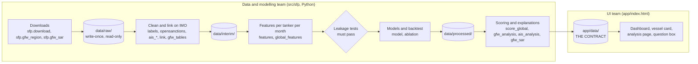

# How the tool is built

Written 2026-10-17. This is the map for the two teams working on the tool:

- the **data and modelling team**, which owns everything in `src/` and `data/`;
- the **UI team**, which owns `app/index.html`.

The two teams meet at one interface: the generated files in `app/data/`. The data team writes them. The UI only reads them. The UI never computes a risk number itself, and the pipeline never writes HTML. Keep that line, and either side can change its internals without breaking the other.

For the specs, see `CLAUDE.md` and `docs/`. For research and decisions, see `reports/`.

## 1. The big picture



Everything runs from one script:

| Command | What it does |
| --- | --- |
| `./run.sh setup` | Creates `.venv` and installs `requirements.txt`. |
| `./run.sh download` | Downloads everything; resumable, so rerun it to continue. Global Fishing Watch needs `GFW_API_TOKEN` in `.env`. |
| `./run.sh build` | Runs every stage in `sfp.pipeline` and stops on the first failure, including a failed leakage test. Add `--skip-global` for Danish AIS only. |
| `./run.sh serve` | Serves `app/` at http://localhost:8000. |

## 2. Repository layout and ownership

| Path | Owner | In git? | Contents |
| --- | --- | --- | --- |
| `src/sfp/` | Data | yes | Pipeline stages (one module per stage). Shared settings are in `config.py` and `paths.py`. |
| `src/sfp/config.py` | Data | yes | **Every threshold and assumption**, each with a comment. The UI's sourced figures (penalties, hull values, oil price) come from here too. |
| `data/raw/` | Data | no (only `manifest.jsonl`) | Downloads as received. Never edited. |
| `data/interim/`, `data/processed/` | Data | no (only `*.manifest.json`) | Derived tables, features, scores, backtests. |
| `app/index.html` | UI | yes | The whole front end: one file, no build step, no framework. |
| `app/data/` | Data writes, UI reads | **no** | The contract (section 3). It is regenerated by `./run.sh build`. |
| `reports/` | Both | yes | Findings, strategy, charts for the pitch. |
| `docs/`, `README.md`, `CLAUDE.md` | Project leads | yes | Specs and rules. |

**How the UI team gets `app/data/` without running the full pipeline:** the data team zips `app/data/` (about 50 MB) after each build and shares it outside git. Unzip it into `app/` and run `./run.sh serve`.

The bundle is real data under non-commercial licences (Global Fishing Watch, OpenSanctions). Never commit it.

## 3. The contract: `app/data/`

Six outputs, each loaded either as a `<script>` that sets one global or as JSON fetched on demand.

| File | Global / access | Written by | Loaded |
| --- | --- | --- | --- |
| `vessels.js` | `window.SFP_DATA` | `score_global.py` (global) or `score.py` (Danish-only) | at page load |
| `detail/NN.json` (40 shards) | `fetch("data/detail/NN.json")` | `score_global.py` | when a vessel is opened |
| `land.js` | `window.SFP_LAND` | `score_global.py` | at page load |
| `analysis.js` | `window.SFP_ANALYSIS` | `ais_analysis.py` | at page load |
| `gfw_analysis.js` | `window.SFP_GFW` | `gfw_analysis.py` | at page load |
| `sar.js` | `window.SFP_SAR` | `gfw_sar.py` | at page load |

### 3.1 `vessels.js`: run metadata and the light vessel index

Top-level keys:

| Key | Meaning |
| --- | --- |
| `generated`, `snapshot`, `data_date` | When it was built; the scoring date T (features use data before T only); the date the lists were checked. |
| `scope` | `"global"` or `"dma"`. The UI switches some panels on this. |
| `regions`, `map_box` | Sea-area boxes `[lon_min, lat_min, lon_max, lat_max]` and the map extent. |
| `model` | `trained_on` (snapshot dates), `calibrated_on`, `rows`, `positives`, `base_rate_90d`, `params`. |
| `base_rate_90d` | The average 90-day sanction rate in training. Used for "N× the average". |
| `assumptions` | `size_classes` (`max_length`, `class`, `dwt`, `hull_usd`), `cargo_load_factor`, `barrels_per_tonne`, `oil_price_usd_bbl` (default, user-editable). `band_high_x` and `band_medium_x` are **legacy: do not use**. |
| `backtest` | `train`, `test_snapshots[T]`, and `uk_test_batches[label]`. For each model (`random`, `flag_rule`, `rule_score`, `logreg`, `lightgbm`) the last two hold `hits@25`, `hits@50`, `hits@100` and `pr_auc`, plus `population` and `positives_in_population`. |
| `band_stats` | Out-of-sample track record. `months`, `base_rate`, and `bands.{high,medium,low}.{tanker_months, sanctioned, rate}`. |
| `insight_figures` | Sourced figures for the exposure panel: `ofac_ieepa_max_usd`, `ofsi_max_gbp`, `ig_oil_pollution_limit_usd`, `ig_overspill_limit_usd`, `value_5yr_usd{class}`, `hull_range`, `band_*_top_pct`, and `sources{hull, oil, ofac, ofsi, ig}`. **Show the source text next to any number you use.** |
| `sharded` | `true` means the vessel rows below are light and detail must be fetched. |
| `vessels[]` | One light row per vessel (below). |

The light vessel row is everything the dashboard, search, map and watchlist need:

```json
{"imo": "1000394", "name": "…", "mmsi": "241841000", "flag": "GRC",
 "status": "unsanctioned", "p90": 0.0003, "rel": 0.04, "band": "low", "top_pct": 67.02,
 "main_region": "h_med", "names_seen": ["…"], "mmsis_seen": ["…"], "last_seen": "2026-09-27",
 "last_pos": {"lat": 38.4, "lon": 26.1}, "size": {"class": "…", "dwt": 72000, "hull_usd": 26300000},
 "sanctioned_on": "2025-05-20", "shard": 34}
```

| Field | Meaning |
| --- | --- |
| `imo` | The key, always a string. Join everything on IMO, never on MMSI. |
| `status` | `"unsanctioned"` (scored), `"sanctioned"` (already listed, so not scored), or `"no_ais"` (known ship with no usable history, so not scored). |
| `p90` | Calibrated probability of a first UK, EU or US sanction within 90 days. Only for `unsanctioned`. |
| `rel` | `p90 / base_rate_90d`. |
| `top_pct` | Rank among scored tankers at this snapshot; 0 is the riskiest. |
| `band` | From `top_pct`: `high` is the top 1%, `medium` the next 4%, `low` the rest, `null` if not scored. Thresholds are in `config.BAND_*_TOP_PCT`. |
| `main_region` | The `h_*` sea area where the tanker spent the most time. |
| `shard` | `int(imo) % 40`: the detail file to fetch. |

Optional fields are left out when unknown, so always guard against `undefined`.

### 3.2 `detail/NN.json`: everything for one vessel card

Each shard is a JSON object keyed by IMO. A record has every light field above, plus the following.

| Key | Shape | Use |
| --- | --- | --- |
| `size` | `{class, dwt, basis, hull_usd, hull_low, hull_high, age, age_basis}` | Exposure panel. `basis` says where the size came from. |
| `trend` | `[[T, top_pct], …]` | Rank over the out-of-sample months (sparkline). |
| `drivers` | `[{feature, label, value, contrib}]` | Raw model contributions (TreeSHAP log-odds), largest first. |
| `reasons` | `[{feature, title, text, evidence_kind, contrib, evidence[]}]` | **Plain-language reasons, already worded by the pipeline.** Show `title` and `text` as written. `evidence` lists the dated items backing the reason. |
| `evidence` | `[{date, type, kind, lat, lon, text, source}]` | Dated facts. `kind` is one of `port`, `gap`, `hotspot`, `loiter_pair`, `passage`, `dark_passage`, `identity`. `lat`/`lon` may be `null`. |
| `coverage` | `{hours, regions{h_*: hours}, dma_days}` | How much we actually saw. Show it next to the score. |
| `lists` | `[{list, date, kind}]` | List status and port-state detentions, with dates. |
| `history` | `{identity[{from,to,name,flag,mmsi}], ports[{date,port,country,hours,lat,lon}], gaps[{date,hours,intentional}], detentions[{date,authority,reason}]}` | The dossier. Low-band ships get a shortened history to keep the files small. |
| `last_pos` | `{lat, lon, ts, sog, destination, source}` | `source` is set when the position is a 0.1° presence cell rather than an exact fix. |
| `track` | `[[lat, lon], …]` | Danish AIS track on the last sampled day (often empty). |
| `build_year`, `tanker_status`, `length` | scalars | Display only. Registry fields are undated and **not** used by the model. |

### 3.3 Analysis files

- **`analysis.js`:** Danish AIS only. `daily`, `monthly`, `type_mix`, `destinations`, `density.cells`, `corr{features, labels, matrix}`, `top_pairs`, `summary`, `thresholds`.
- **`gfw_analysis.js`:** coverage and behaviour from Global Fishing Watch. `regions`, `region_boxes`, `monthly`, `candidates`, `flag_churn_12m`, `flags_now`, `port_countries`, `events`, `hotspots`, `coverage_sanctioned`, `corr`, `top_pairs`, `summary`.
- **`sar.js`:** satellite radar. `areas{name: [{month, dark, matched, dark_share}]}`, `area_boxes`, `hormuz_index{months, base, series, raw}`, `cells[[lat, lon, n]]`, `window_cells`.
- **`land.js`:** coastline polygons `[[[lon, lat], …], …]`, simplified at 0.012°.

### 3.4 Contract rules (both teams)

1. **Additive changes are free.** The data team may add keys at any time. The UI ignores keys it doesn't know.
2. **Breaking changes need both teams.** Renaming, removing or changing the meaning or shape of an existing key requires agreement and a same-day update to this file and `index.html`.
3. **Unknown means absent, never zero.** Leave a key out, or set it to `null`, when we don't know a value. Never use `0` as a stand-in for "unknown". The UI must show "unknown" or "not covered", which is a required failure case.
4. **Every number shown to a user carries its source and date.** If you add a figure, add its source string too (as in `insight_figures.sources`).
5. **Words come from the pipeline.** Reason titles and texts are written in `score_global.reasons_for()`, so wording rules are enforced in one place. The UI may lay them out, but not rewrite them.
6. **Size budget.** `vessels.js` stays under about 8 MB, each shard under about 2 MB, and a publish under 64 MB. To add heavy per-vessel data, put it in the shards, or in a new on-demand file, never in the index.

## 4. Data and modelling team: how the pipeline works

### 4.1 Stages (in `sfp.pipeline`)

| Stage | Module | Reads | Writes |
| --- | --- | --- | --- |
| Labels | `labels.py` | UK, EU, OFAC raw lists | `interim/labels.parquet` (first sanction date per IMO, by authority) |
| Other lists and detentions | `opensanctions.py` | OpenSanctions datasets | `interim/os_vessels`, `interim/os_events` (each with `known_at`) |
| Danish AIS | `ais_reduce.py`, `ais_events.py`, `link.py` | DMA daily CSVs | positions, ship-days, ship-to-ship meetings; `vessel_master`, `mmsi_imo` |
| Danish features and model | `features.py`, `leakage_test.py`, `model.py --set dma`, `ais_analysis.py` | interim | `processed/features.parquet`, `backtest.json`, `app/data/analysis.js` |
| Global Fishing Watch tables | `gfw_tables.py` (raw from `gfw_region.py`) | `raw/gfw/*` | `interim/gfw_presence`, `gfw_identity`, `gfw_registry`, `gfw_events`, `gfw_lastpos`, `gfw_candidates` |
| Satellite radar | `gfw_sar.py` | `raw/gfw/sar`, PortWatch | `interim/gfw_sar*`, `app/data/sar.js` |
| Global features | `global_features.py` | interim, plus Danish snapshot features | `processed/features_global.parquet` |
| Leakage test | `leakage_test_global.py` | inputs truncated before each T | pass/fail; **the build stops on fail** |
| Model and backtest | `model.py --set global`, `ablation.py` | features | `model_lgbm_global.txt`, `model_meta_global.json`, `backtest_global.json`, `scores_all_snapshots_global.parquet`, `ablation.json` |
| Scoring and explanations | `score_global.py` | everything above | `app/data/vessels.js`, `detail/*.json`, `land.js` |
| Coverage analysis | `gfw_analysis.py` | interim, processed | `app/data/gfw_analysis.js` |

### 4.2 Core design rules (from `CLAUDE.md`; not negotiable)

- **Grain:** one row per tanker (IMO) per monthly snapshot T.
- **No temporal leakage:**
  - every input is filtered to before T;
  - dated facts use their *known-at* date (port-state detention +30 days, listing date, first seen);
  - undated fields are display-only.
- **Population:** found by where ships sailed, never from a sanctions list.
- **Label:** first sanction by UK, EU or OFAC within 90 days of T. The training cut-off is 2026-05-01; later months are test only.
- **Choices:** made on the validation split inside training, never on test months.
- **Thresholds:** live in `config.py` with an "ASSUMPTION" comment.
- **Provenance:** every download is logged in `data/raw/manifest.jsonl`, and every stage writes a manifest.

### 4.3 Recipe: adding a new signal (for example, IACS class withdrawal)

1. **Download.** Add the source to `download.py`, using `fetch()`, which is write-once and logs the manifest. Log it in `docs/DATASETS.md`.
2. **Clean.** Write a stage that turns raw files into a tidy table in `data/interim/`, keyed on `imo`, with a `known_at` date for each row.
3. **Feature.** In `global_features.py`:
   - compute it inside `snapshot()` using only rows with `known_at < T`;
   - add the column name to `FEATURES` (and to `MONOTONE` if its direction is known);
   - add a human label to `LABELS` in `score_global.py`.
4. **Leakage test.** Add the input to the truncation in `leakage_test_global.py`. It must pass.
5. **Is it worth it?** Add it as a group in `ablation.py` and compare validation lift. Keep it only if validation improves; report test results without choosing on them.
6. **Explain it.**
   - In `reasons_for()`, add a reason template: title, plain text with a comparison against other tankers, and `evidence_kind`.
   - In `evidence_for()`, add dated evidence items with a new `kind`.
   - Every elevated score must keep at least one evidence-backed reason.
7. **Expose it.** Put any new per-vessel display data into the vessel record, so it lands in the shards automatically. Document the new key in section 3 of this file.
8. **Rebuild** with `./run.sh build`, share the new `app/data/` bundle, and tell the UI team which keys are new.

### 4.4 Language rules for anything written into the contract

- Outputs are **risk indicators for human review**.
- Never call a named ship "shadow fleet" as a verdict.
- Stay neutral on the conflict.
- Say "not covered" where we lack data.

## 5. UI team: how the front end works

### 5.1 Structure of `app/index.html`

There is one page with three views, switched by the URL hash in `route()`:

| Hash | View | Main functions |
| --- | --- | --- |
| `#home` | Dashboard | **Left:** past searches (`renderPast`, from localStorage `sfp_past`).<br>**Right:** search (`search`).<br>**Below:** KPIs (`renderKpis`), watchlist (`renderWatch`), exposure by sea area (`renderAccum`), backtest (`renderBacktest`), fleet map (`fleetMap`). |
| `#vessel-<IMO>` | Vessel card and report | `renderVessel` → `loadDetail` (fetches and caches the shard).<br>**Left, risk card:** score, rank, track record, trend, map, exposure by audience, recommended action, list status.<br>**Right:** reasons, evidence, history (`historyHtml`), question box (`ask`). |
| `#analysis` | Analysis | `renderAnalysis`, `renderGfw`, `renderSar`, `heatmap`, `hbars` |

Shared helpers:

| Helper | What it does |
| --- | --- |
| `mapSvg(box, opts)` | Inline-SVG map with coastline. |
| `enableZoom(el)` | Pan and zoom by wheel, pinch, drag and buttons. Use it on every map. |
| `showTip` / `tipOn` | Hover tooltips. |
| `exposure(v)` / `exposureHtml(v, x)` | Cargo and hull value per audience, from `D.assumptions` and `D.insight_figures`. |
| `action(v)` | Recommended-action wording by status and band. |
| `AUD` | The four audiences: bank, insurer, reinsurer, shipping. Each has an exposure basis and an explainer. |

Preferences kept in `localStorage`: `sfp_past` (past searches), `sfp_aud` (audience), `sfp_oil` (oil price). Every access is wrapped in try/catch.

**The question box** uses the claude.ai `sample` capability (`claude.use("sample")`). It is hidden when that capability is unavailable, so the page must work without it. The prompt in `RULES(v)` sends only the vessel's own evidence and instructs Claude to answer only from it.

### 5.2 Rules for the UI

- **Read, don't compute.** Probabilities, ranks, bands and reasons come from the contract. Formatting is fine (percentages, sizes); recalculating risk is not. The exposure maths is the one exception: it combines sourced figures from `insight_figures` with the user-editable oil price.
- **Always show coverage and the failure case:**
  - `no_ais` and missing `coverage` must show "not enough data", never a low score;
  - show `snapshot` and `data_date` on the card.
- **Sources next to numbers.** Use `insight_figures.sources` and the evidence `source` field.
- **No build step, no external data at run time.**
  - Scripts from CDNs only if pinned to an exact version.
  - Light and dark themes come from CSS variables on `:root`.
  - Phone width has to work.
- **Wording comes from the pipeline** (contract rule 5). New UI copy follows `docs/AUDIENCES.md`.

### 5.3 Recipe: adding a UI feature

1. Check whether the data already exists in section 3. If it does, build against it.
2. If it doesn't, write a short request to the data team: the key name, its shape, and whether it belongs in the index or the detail shards. Agree it before building.
3. Until the data lands, develop against a hand-made record. Never ship it: mark it **SYNTHETIC** in code and on screen, and remove it before merging.
4. Guard every new key (`v.newKey?.…`), so the page still works with an older `app/data/`.

## 6. Shipping the demo

There are two ways to show the demo:
- **Locally:** `./run.sh serve`.
- **The published claude.ai page:** `app/index.html` plus all of `app/data/` (index, shards, analysis files), republished to the same URL. It declares the `sample` capability for the question box. Publishing is done from a Claude Code session; the page is private until shared.

## 7. Working together

- **Branches:**
  - `data/<topic>` for `src/`, `config.py` and `reports/`;
  - `ui/<topic>` for `app/index.html`;
  - a change to this file goes in the same pull request as the change it describes.
- **Sync points:**
  - after each build, the data team posts what changed in the contract (new, changed or removed keys) and shares the bundle;
  - the UI team posts which keys it now depends on.
- **Before a number goes in the pitch or README:**
  - run the leakage tests (they run in `./run.sh build`);
  - check its provenance;
  - run the `data-auditor` review.
- **Never commit** data, `.env` or model binaries. `.gitignore` already covers them.

## 8. Open work, by team

**Data and modelling:**
1. **IACS class-withdrawal feature.** Raw files are in `data/raw/iacs/`, including 12 archived weekly copies from 2025-10-31 to 2026-09-18.
   - It has to be built from the latest copy published before each snapshot. Earlier snapshots get "unknown".
   - First check (May–July 2026, using the 2026-03-06 copy): tankers that had left class were sanctioned at 5.5× the average rate.
2. **Owner and manager links** taken from the sanctions lists ("same manager as an already-sanctioned ship").
3. **Near-shore ship-to-ship transfer detection** at the Greek, Maltese, Egyptian and Turkish hotspots.
4. **More GFW sea areas:** Turkish straits approaches, North Africa, West Africa.
5. **More AIS:** download the Norwegian AIS archive (HAIS) for the Barents route, and start recording Digitraffic for the Gulf of Finland.
6. **A second model for follow-on designations:** "listed by the EU or US: will the UK follow?"

**UI:**
1. A one-page vessel memo export for a bank's audit file (`downloads` capability or print CSS).
2. A voyage timeline map: port calls and loitering in order, from `history.ports` and `evidence`.
3. Counterpart profiles for each `loiter_pair` evidence item, linking to that ship's card.
4. A follow-on view ("already listed by EU/US, not yet by UK") once the second model exists.
5. Show `coverage` more prominently on every card.
